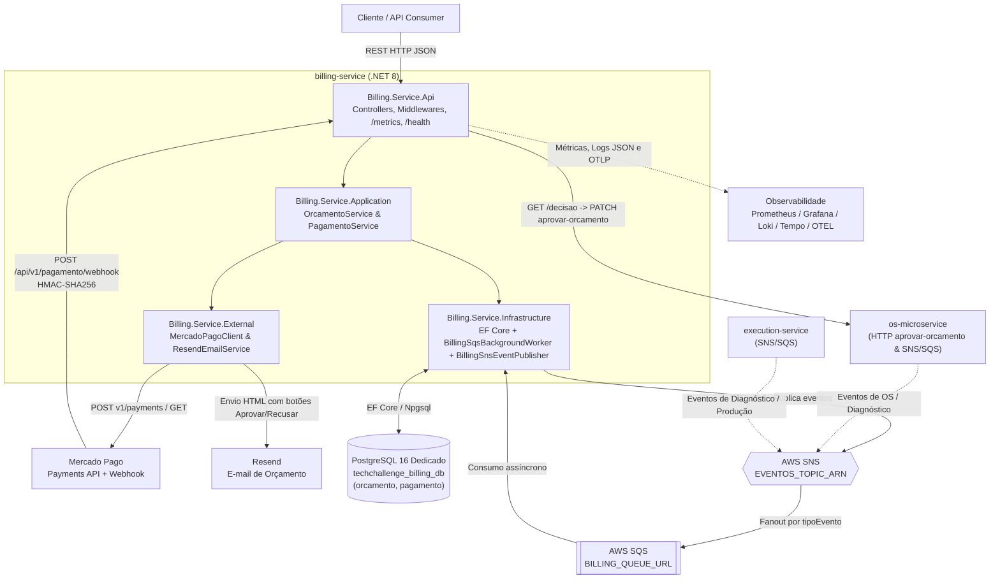
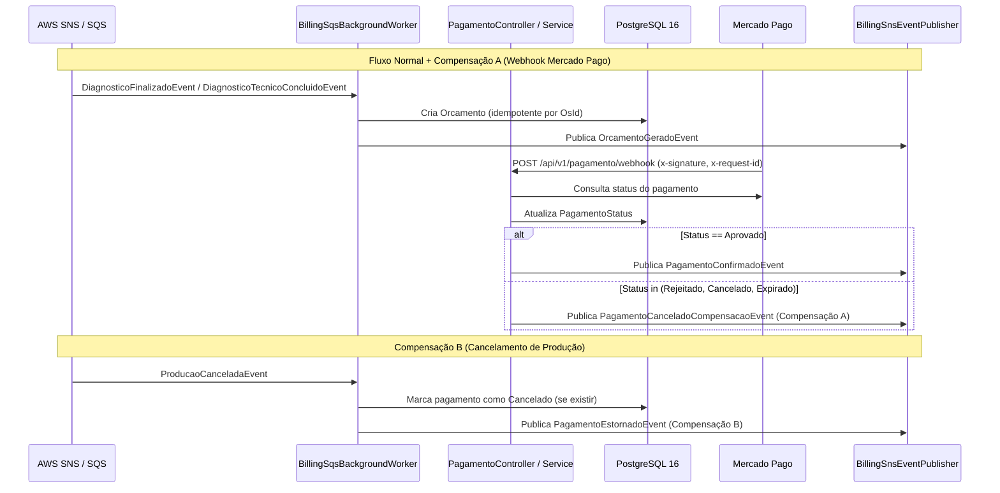

# billing-service

Microsserviço responsável por **orçamentos, emissão de boletos, confirmação de pagamentos via Mercado Pago, notificações por e-mail (Resend) e participação na Saga coreografada** do ecossistema Tech Challenge (SOAT/FIAP — Fase 4).

---

## Visão Geral da Arquitetura

O `billing-service` foi estruturado em **Clean Architecture** sobre **.NET 8 (ASP.NET Core)**, com separação explícita de responsabilidades entre camadas:

| Camada / Projeto | Responsabilidade |
|---|---|
| `src/Billing.Service.Api` | Controllers REST (`v1`), middlewares (`CorrelationIdMiddleware`, `RequestObservabilityMiddleware`, `ExceptionHandlingMiddleware`), Swagger, Prometheus (`/metrics`), health checks (`/health`, `/health/live`, `/health/ready`), OpenTelemetry e hosting opcional em AWS Lambda (`AddAWSLambdaHosting`) |
| `src/Billing.Service.Application` | Casos de uso (`OrcamentoService`, `PagamentoService`), DTOs e abstração de publicação de eventos (`IBillingEventPublisher`) |
| `src/Billing.Service.Domain` | Entidades (`Orcamento`, `Pagamento`, `PagamentoStatus`), Value Objects (`ValorMonetarioVO`, etc.), exceções de domínio e contratos de repositório/serviço |
| `src/Billing.Service.Infrastructure` | Persistência EF Core / Npgsql (`ApplicationDbContext`), migrations, repositórios e mensageria AWS (`BillingSqsBackgroundWorker`, `BillingSnsEventPublisher`) |
| `src/Billing.Service.External` | Integrações externas com Mercado Pago (`MercadoPagoClient` com suporte a modo real e mock determinístico) e Resend (`ResendEmailService`) |
| `Fiap.TechChallenge.Contracts` | Pacote compartilhado (`../shared`) com contratos HTTP, eventos de integração e helpers de correlação (`IntegrationEvent`, `CorrelationContext`, `SnsCorrelationHelper`) |

### Isolamento de Banco de Dados (Database-per-Service)

- **Banco dedicado:** **PostgreSQL 16** isolado (`techchallenge_billing_db` no ambiente integrado via `shared/docker-compose.yml`; fallback local `billingdb` no `docker-compose.yml` standalone e `Program.cs`; Amazon RDS PostgreSQL em produção conforme [RFC-002](docs/rfcs/RFC-002-managed-database-choice.md)).
- **Tabelas exclusivas:** `orcamento` e `pagamento`, gerenciadas via Entity Framework Core (`ApplicationDbContext`) com migrations aplicadas automaticamente na inicialização da API (`db.Database.Migrate()`).
- **Zero acoplamento em nível de dados:** Nenhum outro microsserviço acessa o banco do `billing-service`, e o `billing-service` não acessa os bancos de `os-microservice` (DynamoDB), `execution-service` (PostgreSQL) ou `fase1-tech-challenge` (PostgreSQL). A tabela `orcamento` referencia a Ordem de Serviço apenas pelo identificador lógico `id_ordem_servico` (índice único), sem foreign keys cruzadas.

### Diagrama de Arquitetura



### Documentação Arquitetural (`docs/`)

- [Índice da Documentação (`docs/README.md`)](docs/README.md)
- [Diagrama de Componentes (`docs/component-diagram.md`)](docs/component-diagram.md)
- [Diagrama de Sequência (`docs/sequence-diagram.md`)](docs/sequence-diagram.md)
- [Modelo de Dados (`docs/database-model.md`)](docs/database-model.md)
- [Observabilidade (`docs/observability.md`)](docs/observability.md)
- [Relatório de Validação (`docs/validation-report.md`)](docs/validation-report.md)
- [ADRs (`docs/adrs/`)](docs/adrs/ADR-001-communication-pattern.md) e [RFCs (`docs/rfcs/`)](docs/rfcs/RFC-001-cloud-provider-choice.md)
- [Coleção Postman (`docs/postman/billing-service.postman_collection.json`)](docs/postman/billing-service.postman_collection.json)

### Endpoints Principais

| Método | Rota | Finalidade |
|---|---|---|
| `POST` | `/api/v1/orcamento` | Gera ou recalcula orçamento a partir de serviços e peças (`idOrdemServico` opcional na query) |
| `GET` | `/api/v1/orcamento/{id}` | Consulta orçamento por ID |
| `GET` | `/api/v1/orcamento/listar` | Lista orçamentos paginados |
| `POST` | `/api/v1/orcamento/{id}/enviar-orcamento` | Envia e-mail HTML com orçamento via Resend |
| `GET` | `/api/v1/orcamento/{id}/decisao` | Recebe clique de aprovação/recusa e chama `PATCH /api/v1/ordens-servico/{id}/aprovar-orcamento` |
| `POST` | `/api/v1/pagamento/boleto` | Cria boleto no Mercado Pago e persiste pagamento pendente |
| `GET` | `/api/v1/pagamento/{id}` | Consulta pagamento persistido |
| `POST` | `/api/v1/pagamento/webhook` | Recebe notificação do Mercado Pago, valida assinatura HMAC-SHA256 e publica resultado na Saga |
| `GET` | `/api/ping` | Verificação simples (`pong`) |
| `GET` | `/health` \| `/health/live` \| `/health/ready` | Health checks de processo e conectividade PostgreSQL |
| `GET` | `/metrics` | Scraping de métricas Prometheus |
| `GET` | `/swagger` | Documentação OpenAPI / Swagger UI |

---

## Implementação e Justificativa do Saga Pattern

O `billing-service` participa da **Saga Híbrida** do ecossistema atuando via **Saga Coreografada sobre mensageria assíncrona AWS SNS/SQS**.

### Justificativa da Escolha Arquitetural

1. **Operações de longa duração e assincronismo natural:** A emissão de boleto e a confirmação de pagamento pelo Mercado Pago (além da aprovação do orçamento pelo cliente via e-mail) não ocorrem na mesma janela temporal de uma requisição síncrona. Manter transações distribuídas bloqueantes ou coordenadores síncronos entre `os-microservice`, `execution-service` e `billing-service` causaria acoplamento temporal e propagação de falhas.
2. **Persistência poliglota sem transações ACID compartilhadas:** Como o `billing-service` utiliza **PostgreSQL 16** dedicado (`techchallenge_billing_db`), o `os-microservice` usa **DynamoDB** e o `execution-service` usa outro **PostgreSQL 16** isolado, não é possível usar transações locais compartilhadas nem *Two-Phase Commit (2PC)*. A consistência entre serviços é garantida por **consistência eventual** dirigida a eventos.
3. **Por que Coreografada (SNS/SQS) no Billing Service:**
   - **Desacoplamento e extensibilidade:** O `billing-service` apenas reage a eventos de domínio publicados no barramento AWS SNS/SQS e publica os fatos de faturamento/pagamento no tópico `EVENTOS_TOPIC_ARN` (`Aws:EventosTopicArn`), sem precisar conhecer quais serviços consomem seus eventos (ex.: `os-microservice` ou novos assinantes futuros).
   - **Resiliência e controle de concorrência:** O consumidor `BillingSqsBackgroundWorker` faz polling contínuo na fila SQS (`BILLING_QUEUE_URL` / `Aws:BillingQueueUrl`), suporta envelopes `SNS Notification` e payloads diretos, e garante idempotência na geração de orçamento verificando a existência prévia por `IdOrdemServico` (`AnyAsync(o => o.IdOrdemServico == evento.OsId)` + índice único em `orcamento.id_ordem_servico`).
   - **Rastreabilidade ponta a ponta:** `BillingSqsBackgroundWorker` e `BillingSnsEventPublisher` extraem e propagam `OsId` e `X-Correlation-ID` (`SnsCorrelationHelper`, `CorrelationContext` e `SnsMessageAttributes`), correlacionando logs estruturados e eventos distribuídos entre todos os microsserviços.

### Eventos Consumidos (`BillingSqsBackgroundWorker`)

| Evento (`tipoEvento`) | Origem | Ação no `billing-service` |
|---|---|---|
| `DiagnosticoFinalizadoEvent` (`DiagnosticoFinalizado`) | `os-microservice` | Verifica idempotência por `OsId`, cria o `Orcamento` no PostgreSQL (usando `Total` ou soma dos `Itens`) e publica `OrcamentoGeradoEvent`. |
| `DiagnosticoTecnicoConcluidoEvent` (`DiagnosticoTecnicoConcluido`) | `execution-service` | Verifica idempotência por `OsId`, calcula e cria o `Orcamento` no PostgreSQL a partir de `Servicos` e `Pecas` sugeridos e publica `OrcamentoGeradoEvent`. |
| `ProducaoCanceladaEvent` (`ProducaoCancelada`) | `execution-service` | Executa a **Compensação B**: localiza orçamento e pagamento associado, marca o pagamento como `Cancelado` e publica `PagamentoEstornadoEvent`. |
| `OrdemServicoCanceladaEvent` (`OrdemServicoCancelada`) | `os-microservice` | Localiza o orçamento da OS e, caso haja pagamento com status `Pendente`, atualiza-o para `Cancelado` com o motivo do cancelamento da OS. |

### Eventos Publicados (`BillingSnsEventPublisher`)

| Evento (`tipoEvento`) | Emissor | Quando é Publicado | Efeito na Saga |
|---|---|---|---|
| `OrcamentoGeradoEvent` | `OrcamentoService` / `BillingSqsBackgroundWorker` | Após criação/atualização do orçamento (via endpoint HTTP ou consumo de diagnóstico) | Disponibiliza `OrcamentoId`, `ValorTotal` e `LinkPagamento` no tópico SNS. |
| `PagamentoConfirmadoEvent` | `PagamentoService` | Quando o webhook do Mercado Pago resulta em `PagamentoStatus.Aprovado` | Consumido pelo `os-microservice` para atualizar a OS para `ORCAMENTO_APROVADO` e liberar execução (`OrdemServicoLiberadaParaExecucaoEvent`). |
| `PagamentoCanceladoCompensacaoEvent` | `PagamentoService` | **Compensação A:** quando o webhook resulta em `Rejeitado`, `Cancelado` (incl. `refunded`) ou `Expirado` | Consumido pelo `os-microservice` (`CompensacaoEventoFunction`) para cancelar a OS no DynamoDB e estornar peças reservadas no Core. |
| `PagamentoEstornadoEvent` | `BillingSqsBackgroundWorker` | **Compensação B:** em resposta ao consumo de `ProducaoCanceladaEvent` | Sinaliza conclusão do estorno financeiro lógico da OS para auditoria/compensação no `os-microservice`. |

### Fluxos de Compensação (Compensação A & Compensação B)

- **Compensação A — Falha, Recusa, Cancelamento ou Expiração de Pagamento:**
  Ao receber uma notificação em `POST /api/v1/pagamento/webhook`, o `PagamentoController` valida a assinatura HMAC-SHA256 (`x-signature` e `x-request-id` quando `MercadoPago:WebhookSecret` está configurado) e delega ao `PagamentoService.AtualizarPorNotificacaoAsync`. Se o status consultado no Mercado Pago for mapeado para `Rejeitado`, `Cancelado` (`cancelled` ou `refunded`) ou `Expirado`, o pagamento é atualizado no PostgreSQL e o serviço publica `PagamentoCanceladoCompensacaoEvent` (`{ OsId, Motivo }`) no SNS, disparando no `os-microservice` o cancelamento da OS e a devolução das peças ao estoque do Core.
- **Compensação B — Cancelamento Interno na Oficina (Produção Cancelada):**
  Quando o `execution-service` cancela uma ordem em produção e emite `ProducaoCanceladaEvent`, o `BillingSqsBackgroundWorker` consome a mensagem via SQS, localiza o orçamento por `OsId` e o pagamento vinculado no PostgreSQL, altera o status do pagamento (quando encontrado) para `PagamentoStatus.Cancelado` com detalhe `"Estorno por cancelamento de produção: {Motivo}"`, e publica `PagamentoEstornadoEvent` (`{ OsId, PagamentoId, ValorEstornado }`) no SNS. Caso não exista pagamento registrado para o orçamento, o evento é publicado com `PagamentoId = Guid.Empty` e o valor do orçamento (ou `0m`); não há chamada externa de refund na API do Mercado Pago.



---

## Pagamento via boleto

O backend integra o Mercado Pago pela Payments API (`payment_method_id=bolbradesco`).
Configure estas variáveis antes de iniciar a API:

```text
MercadoPago__AccessToken=<Access Token de teste ou produção>
MercadoPago__NotificationUrl=https://seu-dominio/api/v1/pagamento/webhook
MercadoPago__WebhookSecret=<segredo da assinatura do webhook>
ConnectionStrings__DefaultConnection=<connection string do PostgreSQL>
RESEND_API_KEY=<API key do Resend>
RESEND_FROM_EMAIL=<remetente verificado no Resend>
BILLING_PUBLIC_BASE_URL=<URL pública do Billing Service>
ORDEM_SERVICO_API_BASE_URL=<URL pública da Lambda de ordens de serviço>
```

No GitHub Actions, cadastre `MERCADO_PAGO_ACCESS_TOKEN` e
`MERCADO_PAGO_WEBHOOK_SECRET` como **Repository secrets**. O workflow de
deploy configura esses valores na Lambda e preserva as demais variáveis já
existentes. A URL de teste atualmente configurada é:

```text
https://figg7rtf4l7sqb2t2fsodkq45m0vmtkt.lambda-url.us-east-2.on.aws/api/v1/pagamento/webhook
```

As chaves `MercadoPago:*` também podem ser definidas no `appsettings.json` ou
em um provedor de configuração .NET. A `NotificationUrl` deve ser HTTPS,
publicamente acessível e apontar para o endpoint de webhook. No painel do
Mercado Pago, configure essa URL para os ambientes de teste e produção,
habilite o evento **Pagamentos** e copie a chave secreta gerada para
`MercadoPago__WebhookSecret`. Nunca versione o access token ou a chave secreta.

Para o endpoint `POST /api/v1/orcamento/{id}/enviar-orcamento`, configure
`RESEND_API_KEY` e um `RESEND_FROM_EMAIL` verificado. O endereço enviado no corpo
da requisição é usado como destinatário; no plano gratuito do Resend, o destino
pode precisar ser o e-mail autorizado da conta.

Os botões do e-mail apontam para `GET /api/v1/orcamento/{id}/decisao` no Billing
Service. Esse endpoint chama a rota `PATCH /api/v1/ordens-servico/{id}/aprovar-orcamento`
da Lambda com `aprovado=true` ou `aprovado=false`. Em produção, as duas URLs
públicas devem ser HTTPS e estar configuradas nas variáveis acima.

Endpoints:

- `POST /api/v1/pagamento/boleto`: cria o boleto a partir de um orçamento.
- `GET /api/v1/pagamento/{pagamentoId}`: consulta o pagamento persistido.
- `POST /api/v1/pagamento/webhook`: recebe atualizações e consulta o pagamento no Mercado Pago.

O webhook valida `x-signature` e `x-request-id` antes de consultar o pagamento.
O identificador pode ser recebido no corpo (`data.id`) ou na query string
(`data.id`), conforme o formato da notificação enviada pelo Mercado Pago.

Exemplo de criação:

```json
{
  "idOrcamento": "00000000-0000-0000-0000-000000000000",
  "email": "cliente@example.com",
  "nome": "João",
  "sobrenome": "Silva",
  "cpf": "12345678909",
  "endereco": {
    "cep": "01311-000",
    "logradouro": "Avenida Paulista",
    "numero": "1000",
    "bairro": "Bela Vista",
    "cidade": "São Paulo",
    "estado": "SP"
  }
}
```

Em desenvolvimento, use as credenciais de teste do Mercado Pago. A migração
`AddPagamentos` cria a tabela necessária; ela é aplicada automaticamente pela API
na inicialização.

---

## Evidências de Testes e Cobertura de Código (≥ 80%)

A suíte `Billing.Service.Tests` (xUnit + FluentAssertions) cobre domínio, casos de uso, controllers, middlewares, observabilidade, clientes externos, mensageria SNS/SQS, testes adversariais e integração da API.

### Resultados Verificados da Execução (`Release`)

| Métrica | Resultado Observado |
|---|---|
| **Total de testes** | **215** |
| **Aprovados (`Passed`)** | **214** |
| **Falhas (`Failed`)** | **1** |
| **Ignorados (`Skipped`)** | **0** |

> **Observação sobre a única falha observada:** o teste `Billing.Service.Tests.Contracts.BillingServiceContractTests.Enums_de_billing_devem_manter_os_valores_do_contrato` falhou contra o contrato atual de `shared/main` (`Fiap.TechChallenge.Contracts`), pois `Enum.GetNames<StatusPagamentoContrato>()` retorna `{"Pendente", "Aprovado", "Rejeitado", "Cancelado", "Expirado"}` (espelhando `PagamentoStatus`), enquanto a asserção do teste esperava `{"Pendente", "Aprovado", "Recusado", "Expirado", "Estornado"}`.

### Cobertura de Código Verificada (`coverlet.runsettings` / `coverage.cobertura.xml`)

| Indicador | Valor Medido | Detalhes |
|---|---|---|
| **Cobertura de Linhas (`line-rate`)** | **89,5%** (`0.895`) | **1.313** linhas cobertas de **1.467** válidas (meta mínima: **80%**) |
| **Cobertura de Branches (`branch-rate`)** | **73,77%** (`0.7377`) | **453** branches cobertos de **614** válidos |

Detalhamento por assembly (`src/`):

| Projeto (`src/`) | Cobertura de Linhas | Cobertura de Branches |
|---|---|---|
| `Billing.Service.Domain` | **95,25%** (`0.9525`) | **84,28%** (`0.8428`) |
| `Billing.Service.Application` | **94,66%** (`0.9466`) | **70,21%** (`0.7021`) |
| `Billing.Service.Infrastructure` | **90,77%** (`0.9077`) | **73,25%** (`0.7325`) |
| `Billing.Service.External` | **90,00%** (`0.9`) | **72,72%** (`0.7272`) |
| `Billing.Service.Api` | **81,50%** (`0.815`) | **72,61%** (`0.7261`) |

O arquivo [`coverlet.runsettings`](coverlet.runsettings) gera relatórios `opencover` e `cobertura`, excluindo assemblies de teste (`[*Tests*]*`), contratos externos (`[Fiap.TechChallenge.Contracts]*`) e migrations (`**/Migrations/*.cs`).

### Comandos para Reprodução

Com o repositório `shared` posicionado ao lado de `billing-service` (`../shared`):

```bash
dotnet build Billing.Service.sln --configuration Release

dotnet test tests/Billing.Service.Tests/Billing.Service.Tests.csproj \
  --configuration Release \
  --no-build \
  --settings coverlet.runsettings \
  --collect:"XPlat Code Coverage" \
  --results-directory /tmp/billing-test-results
```

> Use `--results-directory /tmp/billing-test-results` para manter a árvore de trabalho limpa sem gerar `TestResults/` dentro do repositório.

### Análise Estática e Quality Gate (SonarQube Cloud)

O workflow [`.github/workflows/sonar.yml`](.github/workflows/sonar.yml) executa em `push` para `main` e em `pull_request` (`opened`, `synchronize`, `reopened`):

- **Projeto SonarCloud:** `SOAT-FIAP-2026_billing-service` (organização `soat-fiap-2026`).
- **Coleta de cobertura:** `dotnet build Billing.Service.sln --configuration Release` seguido de `dotnet test tests/Billing.Service.Tests/Billing.Service.Tests.csproj --configuration Release --no-build --settings coverlet.runsettings --collect:"XPlat Code Coverage" --results-directory TestResults`.
- **Escopo analisado:** `sonar.cs.opencover.reportsPaths="TestResults/**/coverage.opencover.xml"`, `sonar.inclusions="src/**/*.cs"` e `sonar.coverage.exclusions="**/Migrations/**"`.
