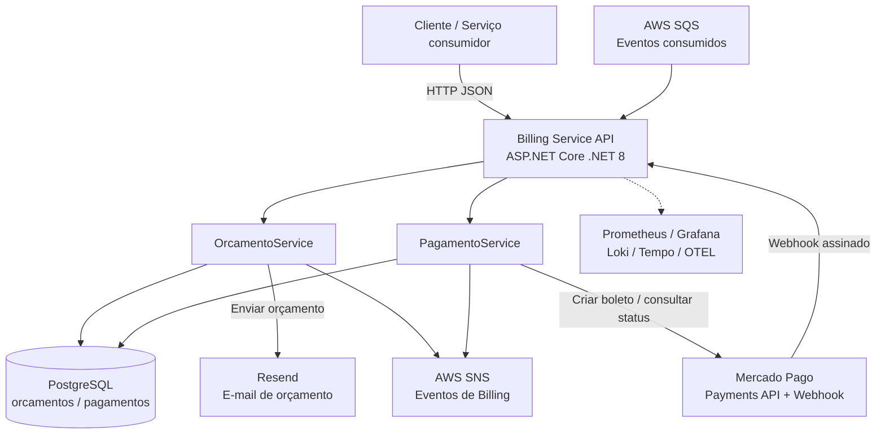

# Diagrama de componentes — Billing Service

## Componentes implantáveis

| Componente | Responsabilidade |
|---|---|
| `Billing.Service.Api` | Controllers, middleware, Swagger, health checks e métricas |
| `Billing.Service.Application` | Casos de uso de orçamento e pagamento |
| `Billing.Service.Domain` | Entidades, value objects e regras de negócio |
| `Billing.Service.Infrastructure` | EF Core, PostgreSQL, SNS e SQS |
| `Billing.Service.External` | Mercado Pago e Resend |
| `Fiap.TechChallenge.Contracts` | DTOs e eventos compartilhados |

A aplicação pode executar em container Kubernetes ou como pacote Lambda conforme o
pipeline utilizado. O banco permanece externo à aplicação e as credenciais são
injetadas por ambiente.
