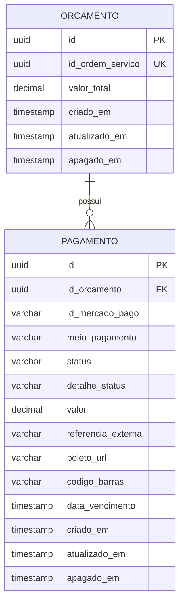

# Modelo de dados — Billing Service

O Billing Service possui um modelo pequeno e transacional, isolado do modelo de
clientes, veículos e ordens de serviço. A ordem de serviço é referenciada apenas
por seu identificador recebido no contrato compartilhado.

## Regras

- `Orcamento.IdOrdemServico` identifica a OS de origem; a OS não é persistida neste
  banco.
- Um orçamento pode possuir pagamentos associados ao longo do ciclo de cobrança.
- Valores monetários são armazenados como `decimal`.
- `PagamentoStatus` cobre `Pendente`, `Aprovado`, `Rejeitado`, `Cancelado` e
  `Expirado`.
- As migrações EF Core são aplicadas na inicialização da API.

PostgreSQL foi escolhido por transações ACID, suporte ao EF Core/Npgsql, integridade
referencial e operação gerenciada em produção. A decisão completa está no
[RFC-002](./rfcs/RFC-002-managed-database-choice.md).
