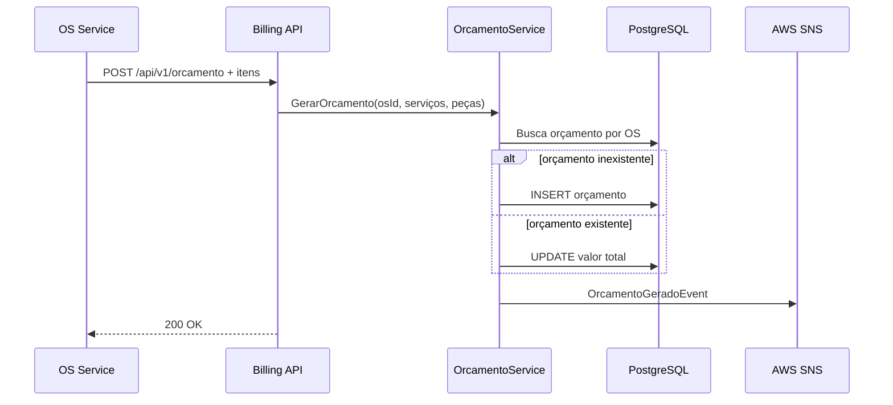
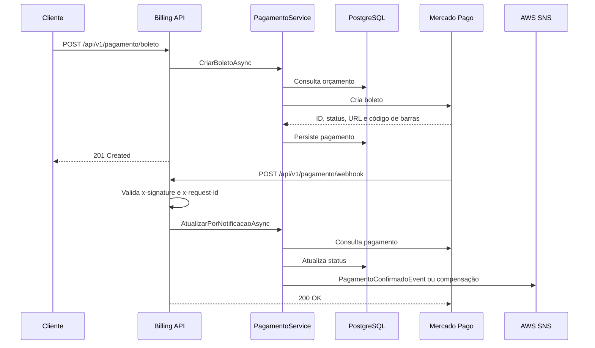

# Diagramas de sequência — Billing Service

## Geração de orçamento

## Criação e confirmação de pagamento

O webhook aceita o identificador em `data.id` no corpo ou na query string. Com
`MercadoPago__WebhookSecret` configurado, assinatura ausente ou inválida retorna
`401 Unauthorized`.
